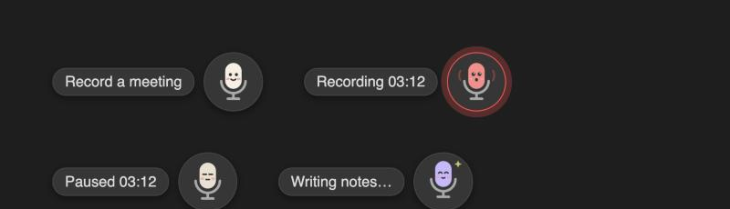
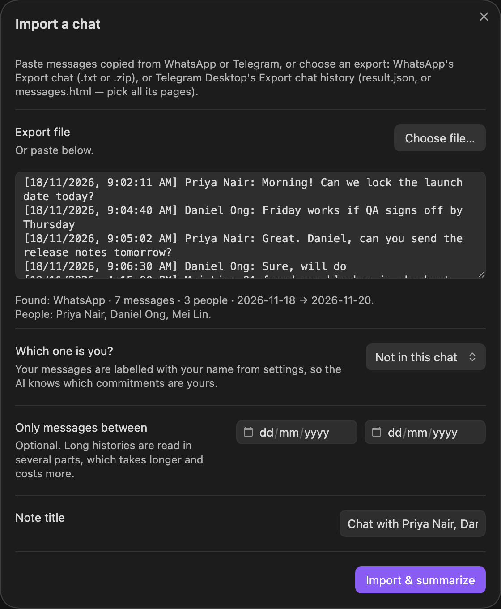
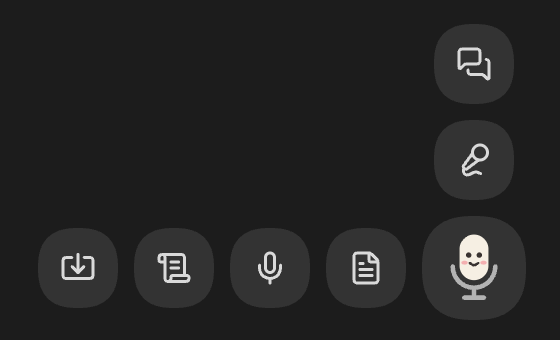
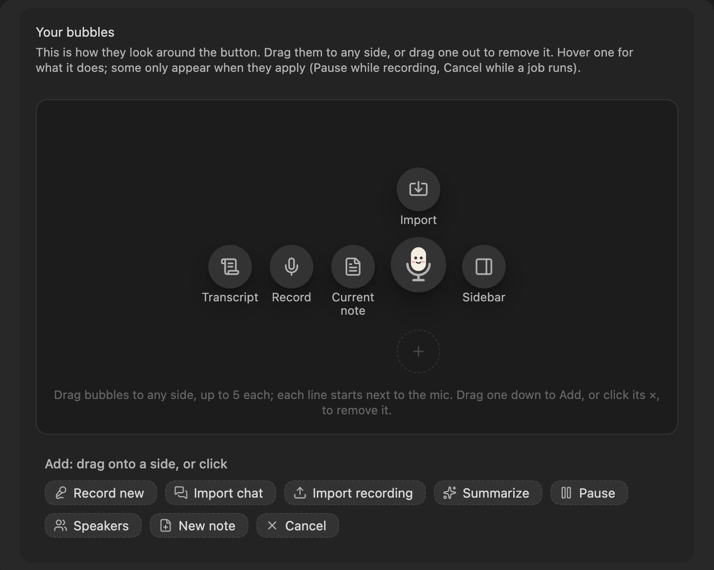

# Take Note

**Meeting notes that write themselves, inside Obsidian.**

Nobody wants to take notes in meetings. Take Note records the meeting, transcribes it
**on your own computer** with Whisper, works out **who said what**, and has an LLM of your
choice turn it into a structured note. It works the same way for things you didn't record:

| 🎙️ Record a meeting | 📁 Import a recording | 💬 Import a chat | ✍️ Paste or type notes |
|---|---|---|---|
| Click the floating mic button | Zoom, Teams or phone audio / video | WhatsApp or Telegram, export or copied messages | Rough notes or a Zoom / Teams / Meet transcript |

📱 **On your phone too:** import chats and summarize notes in Obsidian for iOS and Android.
Recording and transcription need the desktop app.

<p align="center"></p>

## What you get

- 📋 **Summary** and ✅ **decisions**
- 📌 **Action items** as `- [ ]` tasks with owner, priority and 📅 due date (works with the Tasks plugin)
- ❓ **Open questions** and who to ask
- 🎫 **Tickets** (bug / feature / task / improvement) with acceptance criteria
- 🤖 **AI assignments**: work an AI assistant could do for you, each with a ready-to-paste prompt
- 👥 **By person**: what each person reported, committed to and asked
- ⚠️ Risks, 📝 facts worth remembering, 🔜 things to follow up next time

```markdown
## 📌 Action items
- [ ] Send the API design template — [[Alice]] 📅 2026-11-21
- [ ] Investigate the checkout QR issue — [[Bob]]

## 👥 By person
### [[Dana]]
Ran the sync and approved the release plan.
- **Will do**
    - Review search options with the team next week
```

Your own notes, the transcript and the audio stay in the same note. Re-running the AI only
replaces the AI section.

## Contents

- [Quick start](#quick-start)
- [Record a meeting](#record-a-meeting)
- [Import a recording or a transcript](#import-a-recording-or-a-transcript)
- [Import a chat (WhatsApp, Telegram)](#import-a-chat-whatsapp-telegram)
- [The floating button and its bubbles](#the-floating-button-and-its-bubbles)
- [The sidebar](#the-sidebar)
- [Who said what](#who-said-what)
- [FAQ](#faq)
- [Privacy](#privacy)
- [Requirements](#requirements)
- [How it works](#how-it-works)

## Quick start

1. **Local speech tools** (macOS). Clone or download this repo, then run:

   ```bash
   ./scripts/setup-macos.sh
   ```

   This installs `ffmpeg` and `whisper.cpp` with Homebrew, downloads the multilingual
   Whisper model `large-v3-turbo-q5_0` (~574 MB), and installs sherpa-onnx plus two small
   speaker models (~80 MB) into `~/.take-note`. Add `--no-speakers` to skip speaker
   separation. Only need chats and pasted notes? You can skip this step.

2. **The plugin.** Either:
   - **Manual:** download `main.js`, `manifest.json` and `styles.css` from the
     [latest release](https://github.com/stevelohwc/obsidian-take-note/releases/latest)
     into `<your vault>/.obsidian/plugins/take-note/`, or
   - **BRAT:** install the [BRAT](https://github.com/TfTHacker/obsidian42-brat) plugin and add
     `stevelohwc/obsidian-take-note`.

   Then reload Obsidian and enable **Take Note** in Settings → Community plugins.

3. **Settings → Take Note**
   - **Provider**: pick OpenAI, Claude, OpenRouter, Ollama, LM Studio or Other.
   - **API key**: paste it for OpenAI / Claude / OpenRouter (each has a "Get a key" link).
     Switching providers remembers each one's key and model.
   - **Model**: click **Load models** and pick one. Claude starts on Claude Opus 5.5.
   - **Your name**: so "I will…" in your notes becomes your action item.
   - **Extra instructions** (recommended): team context, such as who the initials in your notes
     are, client names and ticket conventions. It makes a big difference.
   - **Check Whisper setup** / **Check speaker setup** confirm the local tools are found.

Every command is in the command palette (Cmd/Ctrl+P) under "Take Note", and you can give
Start / Stop recording a hotkey.

## Record a meeting

1. Click the floating mic button (or the ribbon icon). It records into the meeting note you
   have open, or starts a new one.
2. Type your own notes under **My notes** while it records, and watch the **live transcript**
   in the sidebar.
3. Click the red timer in the status bar (or the mic button) to stop.

The transcript and the AI notes appear on their own. A recording stopped within 20 seconds is
treated as a mis-tap and thrown away (change it in settings). The recording is written to disk
every second, so a crash loses nothing.

**Online meetings with headphones.** The microphone only hears you. To capture everyone,
use the meeting app's own recording or transcript and import or paste it, or route system
audio into an input device with a tool like
[BlackHole](https://github.com/ExistentialAudio/BlackHole) and pick that device under
Settings → Microphone.

## Import a recording or a transcript

| You have… | Do this |
|---|---|
| An audio or video file | **Import a recording…** It's transcribed into a new note; the file is not copied into the vault. |
| A Zoom / Teams / Meet transcript | Paste it into a note and run **Summarize & extract…** |
| Only rough notes | **New meeting note**, type, then run **Summarize & extract…** |
| Edited notes after the AI ran | Run **Summarize & extract…** again. It only replaces the AI section. |

## Import a chat (WhatsApp, Telegram)

Group chats are full of decisions and promises that nobody writes down. Run
**Import a chat…** (from the command palette, the button's right-click menu, or a bubble) and
paste messages you copied, or choose an export file.

<p align="center"></p>

| App | How to export | File to choose |
|---|---|---|
| WhatsApp (phone) | Open the chat → contact or group name → **Export chat** → *Without media* | the `.zip` (iPhone) or `.txt` (Android) |
| Telegram Desktop | Open the chat → ⋮ → **Export chat history**, format *Machine-readable JSON* | `result.json` |
| Telegram Desktop (HTML export) | Same, format *HTML* | `messages.html` (select `messages2.html`… too for long chats) |
| Any app | Select the messages and copy them | paste into the box |

It shows what it found: messages, people and date range. Pick **which one is you**, so your
messages get your name from settings and the AI knows which commitments are yours, and
optionally narrow the dates. Long histories are read in several parts, so a shorter range is
faster and cheaper.

The new note gets:

- a `chat` tag, `chat_start` / `chat_end` dates, and everyone who wrote in `people`
- a **Chat** section with one line per message and a line for each day
- the same summary, action items and per-person notes as a meeting

Relative dates ("tomorrow", "Friday") are worked out from the day each message was sent.
Photos, voice messages and files show up as markers like `[photo]`; the AI can't see them.
Text it doesn't recognise as a chat is imported as it is, and the AI still reads it.

## The floating button and its bubbles

The mic button floats over your notes and changes face while it listens, pauses and thinks.
Drag it anywhere, right-click it for every action, or hide it in settings.

**Hover over it** and shortcut bubbles pop out around it:

<p align="center"></p>

You choose which bubbles appear and where: up to **5 on each side** (left, above, right,
below), each line starting next to the mic. Near the edge of the window a line that wouldn't
fit is mirrored to the other side. Set them up in **Settings → Take Note → Floating button →
Your bubbles**: drag bubbles between sides to arrange them, drag one in from **Add**, and drag it
back (or click its ×) to remove it. Arrow keys and Delete work too.

<p align="center"></p>

| Bubble | What it does |
|---|---|
| **Current note** | Opens the note being recorded, else the open meeting note, else the last one you edited |
| **Record** | Records into the open meeting note, else a new one. Stops while recording. |
| **Record new** | Always starts a new meeting note, even when one is open |
| **Transcript** | Opens the current note with the sidebar on its Transcript tab |
| **Import** | A small menu: import a chat or a recording |
| **Import chat** | Straight to the chat import window |
| **Import recording** | Pick an audio or video file to transcribe |
| **Summarize** | Runs the AI on the open note |
| **Pause** | Pauses or resumes the recording (shown only while recording) |
| **Speakers** | Name the speakers in the open note |
| **Sidebar** | Opens the Take Note panel |
| **New note** | An empty meeting note, without recording |
| **Cancel** | Stops a running transcription or AI job (shown only while one runs) |

Out of the box you get **Current note, Record, Transcript and Import** on the left. Turn
**Bubbles on hover** off if you'd rather just click the mic.

## The sidebar

The Take Note panel in the right sidebar follows the meeting note you have open:

- **Summary**: the AI notes. Tick tasks right there.
- **Transcript**: who said what, with a search box. Click a timestamp to play the recording
  from that moment. Chats show here too, by day.
- **Live transcript**: while you record, a draft about 15 seconds behind, made locally by
  Whisper (no tokens) and without speaker names. The full transcript replaces it when you stop.
  Turn it off under **Live transcript** in settings.
- **Notes**: a box for your own notes during the meeting. It saves into the note's "My notes"
  section, which the AI reads. Its toolbar records, summarizes, transcribes and names speakers.

It comes back each time Obsidian starts; turn **Sidebar** off in settings if you don't want it.

## Who said what

Transcripts are labelled by voice, like `[00:03:12] Alice: the release is ready…`. Voices it
has learned are named automatically, and new voices show as `Speaker 1`, `Speaker 2`…

- **After a meeting:** run **Name the speakers in this note**. You see two lines each voice said;
  type who it is. Their voice is remembered for next time. **Save & redo AI notes** regenerates
  the summary with the real names.
- **Or ahead of time:** run **Record a voice sample for a person** and have them read the text
  shown for about 20 seconds.
- **People notes:** with **Update People notes** on, each named speaker's `People/<Name>.md`
  gets a line like `- [[2026-11-19 – Weekly Sync]] — reported the release is ready`.
- **Accuracy:** set **Number of speakers** when you know it; that helps most. If people get
  mixed up, adjust **Voice match strictness** and **Separation sensitivity**.

## FAQ

**Can I use it on my phone?**
Yes, for text. In Obsidian for iOS and Android you can **import a chat** (paste messages, or pick a
WhatsApp or Telegram export), **summarize** any note, and use the sidebar to read the summary and
transcript and tick tasks. Tap the Take Note ribbon button for these, or use the command palette.
The settings show only what works on a phone.

Recording, transcription and speaker separation need the desktop app, because they run Whisper
and other programs on your computer. To capture a meeting on the go, record it with Obsidian's
built-in **Audio recorder** on the phone; once it syncs, run
**Transcribe audio embedded in the current note** on your computer.

On a phone the AI's answer arrives all at once at the end, so there is no live progress while
it writes. Notes made anywhere sync as ordinary Markdown.

**Which model should I use?**
Any of them works. A model with a large context window (32K+) does best on long meetings and
long chats. For private material, run a local model with Ollama or LM Studio.

**Why don't all my action items have a priority?**
Priorities are only kept when your notes or transcript actually contain an urgency word
(urgent, asap, blocker, today…) about that item. Models love to invent priorities otherwise.

## Privacy

- **Audio never leaves your computer.** Recording, transcription (whisper.cpp) and speaker
  separation (sherpa-onnx) all run locally.
- **Only text is sent**, and only to the LLM endpoint *you* configure. Use a local model
  (Ollama, LM Studio) and nothing leaves your machine at all.
- Your API key is stored in your system keychain through Obsidian's secret storage, not in
  the vault.
- Voice fingerprints are stored in `~/.take-note/` on your computer, outside the vault,
  so they never sync. You can forget a voice from the settings at any time.
- Recording people may require their consent where you live. Tell people you are recording.
- An imported chat is stored in the note and its text is sent to your LLM like any other
  note. It contains other people's messages: use a local model for chats you'd rather keep private.

### Disclosures

As required by Obsidian's developer policies:

- **Network use.** The plugin only connects to the LLM provider you choose (OpenAI,
  Anthropic, OpenRouter, or the server URL you enter), to list models and send your meeting
  or chat text. It sends no telemetry and has no ads. The
  optional `scripts/setup-macos.sh` (which you run yourself, not the plugin) downloads
  Homebrew packages, the Whisper model from Hugging Face, and sherpa-onnx from npm and GitHub.
- **Files outside your vault.** It reads and writes `~/.take-note/` (speaker-separation
  runtime and models installed by the setup script, voice fingerprints, per-meeting speaker
  data), reads the Whisper model you configure (default `~/.cache/whisper/`), uses temporary
  files in your system temp folder while transcribing, and reads recordings and chat exports you import.
- **Local programs.** It runs `ffmpeg`, `whisper-cli` and `node` from the paths in settings
  to convert, transcribe and separate speakers. It does not install or update anything itself.
- **Microphone.** Used only while you are recording.
- **Phones and tablets.** Recording, transcription and speaker separation need the desktop app
  (microphone, file system and local programs). On mobile, only chat import, the AI summary and
  the sidebar are offered, and the AI is reached through Obsidian's own network requests.

## Requirements

- Obsidian 1.13.0 or newer. Recording and transcription need the **desktop** app; on phones and
  tablets you can import chats and summarize notes.
- An **LLM**. Built in: **OpenAI**, **Claude (Anthropic)**, **OpenRouter**, plus local
  [Ollama](https://ollama.com) / [LM Studio](https://lmstudio.ai) or any OpenAI-compatible
  server (vLLM, LiteLLM…). A model with a large context window (32K+) gives the best results
  on long meetings.
- **macOS** for the one-step setup script (Apple Silicon or Intel). The plugin itself is
  plain Obsidian + Node, so Linux/Windows should work if you install ffmpeg, whisper.cpp and
  sherpa-onnx yourself and set their paths in settings. This is untested; reports welcome.

## How it works

| File | What it does |
|---|---|
| `src/recorder.ts` | Microphone → `.webm`, written to disk every second so a crash loses nothing |
| `src/transcribe.ts` | ffmpeg → whisper-cli, with speaker separation running in parallel |
| `src/live.ts`, `src/live-audio.ts` | Live transcript: decodes the recording as it is written and transcribes ~12-second pieces cut at pauses |
| `helper/speakers.cjs` | sherpa-onnx speaker separation + voice fingerprints (runs in a Node subprocess) |
| `src/speakers.ts` | Merging split speakers, matching saved voices, labelling transcript lines |
| `src/chat.ts`, `src/unzip.ts` | Reading WhatsApp and Telegram chats (text, zip, JSON and HTML exports) |
| `src/chat-modal.ts` | The Import a chat window |
| `src/providers.ts` | Provider presets (OpenAI, Claude, OpenRouter, Ollama, LM Studio, custom) |
| `src/llm.ts` | Streaming client for any OpenAI-compatible `/chat/completions` |
| `src/claude.ts` | Claude through the official Anthropic SDK, streaming |
| `src/fab.ts`, `src/mascot.ts` | The floating mic button, its mascot and its hover bubbles |
| `src/bubbles.ts`, `src/bubble-editor.ts` | The bubble catalogue and layout, and the drag-and-drop editor in settings |
| `src/view.ts`, `src/sidebar-data.ts` | The sidebar: summary, transcript, audio player |
| `src/extract.ts` | The prompt, JSON parsing, splitting long meetings and chats and merging, priority checks |
| `src/render.ts` | The Markdown written into your note |
| `src/platform.ts` | What the device can do: phones get the text features only |

## Development

```bash
npm install
npm test                                   # unit tests
npm run build                              # typecheck + build main.js
VAULTS="$HOME/path/to/vault" npm run deploy # build and copy into a vault
```

Test the pipeline without Obsidian:

```bash
LLM_MODEL=qwen2.5:14b node scripts/run.ts path/to/meeting.m4a   # or a .md file of notes
```

## Credits

[whisper.cpp](https://github.com/ggml-org/whisper.cpp) ·
[sherpa-onnx](https://github.com/k2-fsa/sherpa-onnx) (pyannote segmentation, 3D-Speaker ERes2Net) ·
[Obsidian](https://obsidian.md)

## License

MIT
